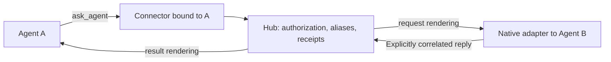

# Automatic agent connections and minimal-awareness collaboration

[简体中文](AGENT_CONNECTOR.zh-CN.md) · [Current architecture](DESIGN.md) · [Delivery status](ROADMAP.md)

Status: **revision 11, implementation underway: both connectors, Codex MCP connect and opt-in Claude CLI connect implemented**. Date: 2026-11-05. Code baseline: `a3093b9ca5a29bc34238529f3271afa062d51cd4`. messageKind, Claude/Codex enrollment, three shared MCP tools, restricted Agent CLI, basic connections diagnostics and both connect paths are implemented but unreleased. See [setup](CONNECTOR_SETUP.md) for actual configuration and limits. Claude native MCP external reload, installer uninstall/disable, manual binding fallback and full read-only readiness diagnostics remain pending. See [API](API.md) and [Verification](VERIFICATION.md) for existing behavior and evidence.

## 1. Decision and V1 scope

Use **native messaging plus a session connector and minimal collaboration tools**. Models express whom to ask, what to ask and which request to answer. Software handles identity, addressing, identifiers, delivery and return routing.

The V1 primary path becomes **automatic binding from native identity on hosts that pass compatibility acceptance**. Owners install the integration profile and authorize its scope; explicit per-session binding is a fallback. One Hub has one implicit team, native-name prefix addresses and optional owner-configured aliases. Models need neither their own session IDs nor polling.

The [2026-11-05 isolated experiment](SESSION_IDENTITY_EXPERIMENT.md) verified Claude startup UUIDs that become stale after `/clear`, and per-call identity in Codex App Server MCP calls. These establish identity inputs; later prototypes verified enrollment and refresh, with subsequent production results in sections 11–12.

The subsequent [roundtrip prototype](CONNECTOR_ROUNDTRIP_EXPERIMENT.md) exercised both directions, binding refresh after clear, old-result isolation and native rename. It uses a temporary registry/result renderer. The subsequent [installation, authorization and lifecycle experiment](CONNECTOR_LIFECYCLE_EXPERIMENT.md) passed fourteen checks, a Codex hot-load retest and a clear race with positive controls. Enrollment prototypes verified credential separation and durable bindings across graceful restart. Production results follow in sections 11–12; configuration tooling and the full compatibility matrix remain incomplete.

| Required for V1                                                                        | Later enhancements                                                                             |
| -------------------------------------------------------------------------------------- | ---------------------------------------------------------------------------------------------- |
| Native identity binding, manual fallback, immutable bindingId, name disambiguation     | Automatic pairing for more hosts, multiple teams, dynamic roles                                |
| ask_agent, reply_agent, optional list_peers                                            | Synchronous waiting, request-specific native reply targets                                     |
| Adapter request/result rendering and reply-ingress checks                              | More harness/host integration automation                                                       |
| Existing receipts, deduplication, first-reply forwarding and one configurable deadline | Separate request state machine, automatic late results, independent return deadline            |
| Necessary message fields/storage version protection and existing capacity limits       | Binding generation state machine, periodic leases, cumulative budgets and granular rate limits |
| Two-Claude and bidirectional Codex/Claude acceptance                                   | Managed-task orchestration, remote integration                                                 |

V1 targets local root sessions, Claude first. Windows completion, Doubao runtime and subagents remain pending. Dedicated managed tasks can retain the existing ACP authorization model in which the host captures task output; that is a separate mode.

## 2. Current facts and evidence

| Existing implementation                                                                 | Design implication                                                               |
| --------------------------------------------------------------------------------------- | -------------------------------------------------------------------------------- |
| Seven MCP tools; send_message requires messageId, composite address and delivery        | Add a smaller model interface while retaining existing contracts                 |
| HTTP tokens identify callers; originName is a label                                     | Session binding is new functionality                                             |
| Both adapters distinguish request/result; result payloads omit reply instructions       | Phase 1 implemented; future connectors reuse the same rendering and reply guards |
| replyTo forwards the first correlated reply and inherits the original expiresAt         | V1 reuses one deadline; independent return windows come later                    |
| Claude uses native sessionId/pid discovery and checks PID format plus socket type/owner | MCP/hook ancestry and process-start identity checks are still new work           |
| SQLite retains receipts, envelopes, fixed forward IDs and recovery state                | Extend existing records rather than creating another request database            |

Code references: [MCP](../src/mcp.ts), [Codex adapter](../src/adapters/codex.ts), [Claude adapter](../src/adapters/claude.ts), [routing](../src/hub.ts), [store](../src/store.ts).

Claude documents native delivery between tool calls while busy, new turns while idle and native replies. Hooks include session_id; Channels require session opt-in. Accordingly, native messaging handles reception, hooks assist lifecycle tracking and MCP exposes initiation. [Messaging](https://code.claude.com/docs/en/cross-session-messaging), [Hooks](https://code.claude.com/docs/en/hooks#sessionstart), [Channels](https://code.claude.com/docs/en/channels).

The reproducible Codex reference is the published [rust-v0.166.0 release](https://github.com/openai/codex/releases/tag/rust-v0.166.0) and its [protocol source](https://raw.githubusercontent.com/openai/codex/rust-v0.166.0/codex-rs/app-server-protocol/src/protocol/v2/thread.rs): ThreadStartParams has dynamic_tools; ThreadResumeParams / ThreadSettingsUpdateParams do not. Native dynamic tools retain creation-time registration. A later experiment separately verified MCP configuration reload for existing threads; these are distinct integration paths.

## 3. Structure and readiness



A connector is a session-level logical boundary implemented through MCP stdio or host tools. Hub shares durable state; adapters handle native messaging. Owners install an integration profile with restricted credentials and an authorized scope. Connectors supply host identity; Hub validates it and creates bindings automatically. Insufficient evidence leaves enrollment pending for explicit owner handling. Model tools become usable after binding and authorization checks.

V1 requires one session per connector. Hosts sharing an MCP process across conversations must supply trusted per-call session context. A global MCP configuration file alone cannot bind the source. Such hosts retain the existing lower-level interface until validated.

Readiness reports binding, connectorAvailable, nativeSessionAvailable, canReceive, canReply, canInitiate and canReturnResult separately, with reasons and check timestamps. Starting Hub can enable native reception without installing initiation tools.

- Existing Claude sessions retain native reception/JSON replies. Interactive CLI integration prefers plugin installation plus `/reload-plugins` to load the smaller tools and then enroll automatically.
- Existing Codex sessions need registered tools and a native listener for replies. Owner-created sessions can initialize these at creation; existing sessions retain explicit attach.
- Tools load through supported host configuration. Installation reports configuration written, tools connected and identity bound separately, with next-launch or explicit-reload guidance for incomplete steps.

### Unified onboarding experience

The confirmed product goal is **one external CLI command completing both installation and activation**. V1 unifies the owner entry point, diagnostics and model operations. A host still requiring manual reload remains an integration gap. These are **proposed commands; Codex connect is implemented; Claude connect reports automatic activation unavailable; connections exposes historical bindings**:

```sh
agenthub serve                         # Existing: start the shared Hub
agenthub connect --harness claude      # Proposed: configure the selected Claude host
agenthub connect --harness codex       # Proposed: configure the selected Codex host
agenthub connections                   # Basic binding diagnostics implemented; full readiness pending
```

Without a harness argument, connect offers discovered instances for selection. A specified harness must still resolve to one instance and an installation scope. Reuse the owner's authorized profile/grants. Installation scope (project/user/instance) is separate from session identity: later sessions in scope can reuse configuration while receiving independent validation and authorization. Repeated setup should reuse configuration/bindings and preserve unrelated MCP/hooks. Selecting one session does not authorize changes to other instances; show the instance-wide effect of Codex reload in the operation scope.

The shared flow is **select scope → preflight automatic activation → install/reuse connector → activate → validate tools/identity → report collaboration capabilities**. Authorized programmatic steps run through the connector. The tested Claude plugin path still needs `/reload-plugins` inside the original session; an external CLI has not replaced that action. Owners need not handwrite MCP JSON, copy session UUIDs or manage separate sending/receiving processes, but fully automatic onboarding of ordinary existing Claude sessions cannot yet be promised.

Installation reports the same capability fields, check timestamps and next-action structure:

| Display                   | Evidence                                                                                                  | Next step                                                         |
| ------------------------- | --------------------------------------------------------------------------------------------------------- | ----------------------------------------------------------------- |
| Collaboration ready       | Current identity validated; initiation, reception, reply and result-return paths available and authorized | Use collaboration tools                                           |
| Partially available       | Only some capabilities hold, such as reception without initiation tools                                   | Show missing capabilities and remedies                            |
| Host action needed        | Configuration written, not yet loaded by this session                                                     | Identify host command/target session or next-normal-launch action |
| Awaiting identity context | Tools available, current-session evidence still missing                                                   | Validate automatically at a host event or first real tool call    |
| Offline / unsupported     | Session unavailable or host entry point not accepted                                                      | Retain the reason and support boundary                            |

These are presentations of capability fields, not a separate durable state machine. CLI text and machine-readable output use the same diagnostics. Next actions carry a target, action type and reason without requiring consumers to parse prose. Written configuration, plugin counts and a living MCP process alone do not establish collaboration readiness. Routine diagnostics remain read-only, without sending probe messages or starting model turns in working sessions.

Identity is unified **before the business operation executes**. Claude can use and continuously refresh its startup UUID. Codex establishes binding from per-call metadata before the first operation, then checks every later call. Matching enrollment timing is not a reason to guess startup identity. The first ask_agent may validate and submit in one invocation; the model still supplies only the target and body. Unconfirmed identity yields an explicit error before dispatch.

Models share logical list_peers, ask_agent and reply_agent tools with the same schemas, handles, deadlines and receipts. Hosts may add MCP namespaces; models need not branch on the destination harness. Explicit @claude/reviewer and @codex/developer addresses are optional; owner aliases can hide those prefixes, while ambiguity still requires disambiguation.

A shared connector core and Hub API handle collaboration; Claude packaging and Codex configuration adapt installation, activation and identity inputs. Preserve native message identity and report unsupported capabilities accurately. This is a design contract: experiments validate its underlying mechanisms, with shared-tool product acceptance now passing; the full installer remains incomplete and section 12 adds opt-in Claude CLI activation. Doubao and unaccepted hosts stay pending.

### connect CLI contract

One command handles first installation and repeated checks. All examples remain proposed:

```sh
agenthub connect
agenthub connect --harness claude --instance local --session-id SESSION_UUID
agenthub connect --harness codex --instance local --session-id SESSION_UUID
agenthub connect --harness claude --session-id SESSION_UUID --wait-ms 30000
```

Without a target, an interactive terminal offers candidates for owner selection. With no interactive input and an ambiguous target, return candidates and stop rather than infer identity from cwd or enroll everything. Reuse --url, --token-file and existing environment variables to reach Hub. Report an unavailable Hub; the existing agenthub serve remains its startup command.

The command detects the host, resolves authorized scope, idempotently installs/reuses configuration, invokes supported activation and checks readiness. Waiting only observes enrollment/connection state. --wait-ms bounds waiting without treating expiry as activation failure. Repeated execution reuses completed steps and never creates replacement sessions. Script stdout contains one JSON result; interaction/progress goes to stderr, without credential values.

| Exit code | Result                                                        | Example                                                                                            |
| --------- | ------------------------------------------------------------- | -------------------------------------------------------------------------------------------------- |
| 0         | Requested collaboration capabilities are ready for the target | Identity, tools, native delivery and return routing validated                                      |
| 2         | Configuration valid but onboarding incomplete                 | Host command or first identity context required, or bounded waiting ended                          |
| 1         | This invocation cannot continue                               | Ambiguous target, unsupported host, insufficient grants, configuration conflict or unavailable Hub |

Results include canonical target, phase, capabilities, check time, nextAction, activation method and supporting evidence. If preflight finds no automatic activation path, return automatic_activation_unavailable (exit 1), preserving current configuration by default. Installation followed by manual instructions is incomplete. Existing pending configuration can explain the original session's /reload-plugins action, but that does not satisfy the automatic requirement. Explain --force only when the host reports cache impact.

Current evidence supports programmatic Codex App Server reload and plugin reload inside a Claude interactive terminal. An external reload control interface for arbitrary existing Claude terminal sessions is not yet verified. Official documentation says slash commands in cross-session messages do not execute; earlier private native history also contains queueSkipSlashCommands: true. Peer text is therefore not an activation implementation. [Claude messaging boundary](https://code.claude.com/docs/en/cross-session-messaging#how-a-session-treats-an-incoming-message)

Fully automatic activation is now a requirement and needs acceptance of the actual entry point. A test driver owning its newly created PTY does not establish control of arbitrary pre-existing terminals. SDK-held Query objects, external existing CLI sessions and bridge-managed processes have separate support records, preserving existing-live integration as the core scope.

### Claude automatic-activation candidate and gap

The [follow-up experiment](CLAUDE_AUTO_ACTIVATION_EXPERIMENT.md) observed that external plugin installation and ordinary local MCP addition did not automatically expose new tools in a non-strict session; the plugin became callable after in-terminal reload. Another candidate adds no MCP: an externally installed skill receives a native collaboration request and invokes a local CLI. Under specific conditions, real calls, native ancestry/UUID correspondence and refreshed IDs after clear passed.

This candidate is not the production default. Empty skills directories had unsuccessful attempts; the successful run also used a loaded baseline skill, project settings and an explicit invocation instruction. These variables remain unisolated. Creating the top-level skills directory after launch still needed manual reload in its controlled test. Directory existence, written configuration and live processes are insufficient activation evidence.

If adopted, skill/CLI keeps the same Hub semantics for the three collaboration operations. The CLI helper obtains source evidence independently; model-supplied session IDs do not authenticate callers. Restricted credentials, independent Hub process checks, real messaging/revocation and host policy need acceptance. Installation must not widen scope or shell permissions to manufacture success. Any model turn needed to verify activation must be explicit integration work; routine read-only diagnostics still send no probes.

### Tested installation paths

| Host and entry point                                       | V1 behavior                                                                                                                                        | Evidence boundary                                                                                                                                                                               |
| ---------------------------------------------------------- | -------------------------------------------------------------------------------------------------------------------------------------------------- | ----------------------------------------------------------------------------------------------------------------------------------------------------------------------------------------------- |
| Codex App Server 0.166.0 / MCP configuration               | Allow explicit `config/mcpServer/reload`; verify connection and an actual tool invocation in the same thread                                       | Succeeded in an existing isolated App Server thread; reload refreshes loaded threads across that instance; CLI/desktop remain untested                                                          |
| Claude 2.1.318 / interactive CLI plugin                    | Install at the owner-selected scope and invoke `/reload-plugins` in the original session; use `--force` if the host warns about cache invalidation | Real model called the new MCP with unchanged PID/UUID; old tools remained callable and uninstall/reload removed the new one; initial strict run did not observe startup                         |
| Claude 2.1.318 / `--strict-mcp-config --mcp-config <file>` | Report next-normal-launch activation; the owner may explicitly resume after normal exit                                                            | New server did not load live; stopped-session resume loaded it with the same UUID; non-strict local MCP addition also did not load automatically; this does not establish project-file behavior |
| Already-loaded Claude MCP server                           | Support explicit host reconnect and renewed helper enrollment/identity validation                                                                  | New MCP PID with the same native session and binding observed                                                                                                                                   |
| Claude project hooks                                       | Use host file watching; await an actual event before reporting lifecycle signals ready                                                             | UserPromptSubmit activated live; this does not replace MCP readiness checks                                                                                                                     |

Disabling a profile immediately denies new Hub operations. Uninstallation merges removal of AgentHub-owned entries while preserving unrelated tools/hooks; the host controls when loaded processes exit. These proposed behaviors follow the [lifecycle prototype](CONNECTOR_LIFECYCLE_EXPERIMENT.md) and [plugin hot-load experiment](CLAUDE_PLUGIN_HOTLOAD_EXPERIMENT.md). Plugins become the preferred installation for the tested CLI; a production plugin remains unimplemented/unpublished. The owner invokes reload in the host; this experiment did not execute the command through peer messaging. Official documentation says the same slash command does not connect new plugin MCP servers in desktop/SDK/`-p` sessions. SDK `setMcpServers()` is a separate host-controlled path, not tested here.

## 4. Minimal tools and waiting experience

Proposed calls:

```text
ask_agent(to="reviewer", message="Check this change for concurrency issues", deadlineSeconds=7200)
reply_agent(request="REQUEST_HANDLE", message="I found two issues: ...")
list_peers()  // Unnecessary when the peer role is already known
```

Optional deadlineSeconds defaults to 3600 seconds. The current helper computes a fixed expiresAt at call start, and Hub validates the remaining window on receipt. The maximum is currently fixed at 14400 seconds; owner-configurable limits remain pending. request is an opaque, reversible representation of the existing messageId, generated by software. The model copies it from the request; recovery does not rely on an in-memory short-number map.

ask_agent is asynchronous. Its response includes the request handle, peer alias, current delivery evidence, expiresAt and guidance, for example:

```json
{
  "request": "REQUEST_HANDLE",
  "peer": "reviewer",
  "deliveryStatus": "accepted",
  "expiresAt": "2026-11-05T12:00:00Z",
  "guidance": "The request was submitted; its answer has not arrived. Continue independent work if useful. If progress depends on the answer, tell the user you are waiting and finish this turn. The result will arrive as a new message; no polling or resubmission is needed."
}
```

This is not proof of task completion. Uncertain delivery returns unknown with guidance to retain the original request and avoid resubmission. Immediate validation failures return tool errors.

| While waiting                               | Behavior                                                                                                                                                  |
| ------------------------------------------- | --------------------------------------------------------------------------------------------------------------------------------------------------------- |
| Independent work is available               | Continue portions of the task that do not need the answer                                                                                                 |
| Progress requires the answer                | Tell the user “Waiting for the review; I will continue when it arrives,” then finish the turn                                                             |
| User asks a new question                    | Continue the user conversation; the collaboration request stays associated with its original task                                                         |
| Result arrives while source is busy         | Deliver at a supported native queue boundary; the model applies current user instructions                                                                 |
| User changed or abandoned the original task | Include the original task summary and handle in the result; the model can retain it as reference and follows current user intent before resuming old work |

Answers return only through one asynchronous message. Result guidance says “This is the result for request X; use it as relevant to the current task. No receipt acknowledgement is needed.” Hub handles correlation; the model follows current user priorities. The integration does not need the user's entire conversation to infer them.

## 5. Identity binding and automatic pairing

### Binding records, authorization and addresses

Verified native evidence and explicit owner action both create the same record:

```ts
interface ConnectorBinding {
  bindingId: string; // Immutable identifier created by Hub
  callerId: string; // Separate restricted caller
  address: SessionAddress;
  alias: string; // Disambiguated Hub address or unique owner-configured alias
}
```

Hub derives source and return routing from this binding. Native names can supply `@claude/reviewer` and `@codex/developer`. Duplicate names exist within each harness, so ambiguous resolution returns candidates requiring instance/ID disambiguation. Keep `{harness, instance, nativeSessionId}` internally and fix the actual address at submission. Native renames affect future resolution; retargeting an alias or changing the native UUID creates a new bindingId. Outstanding requests retain the old identifier. Invalidated bindings keep answers in the original receipt and report binding_unavailable for return dispatch.

Bindings retain existing grants. Enrollment credentials permit evidence submission only; owner-configured grants still authorize actual sessions. Discovery does not grant access. Recheck native availability on sends and returns. Failed automatic identification can fall back to explicit binding of a known current session, which still needs invalidation on session switches.

### Enrollment and operation credentials

V1 follows the tested separation: an owner profile holds authorization scope and an enrollment credential, usable only for identity/hook submission. After validation, Hub issues a connector-process credential bound to PID, start identity and a profile revocation epoch. Each operation derives the current native session again and applies existing grants. Enrollment does not expand access.

Hub persists bindingIds and credential hashes. After graceful restart it restores records and revalidates live processes. A restarted MCP enrolls using new process evidence; the same native UUID can recover the same binding. Owner rotation of enrollment credentials and advancement of the revocation epoch invalidates old operation credentials. Disabling a profile denies enrollment and operations. Credential errors are explicit; reenrollment never blindly resends business writes, which retain receipt/idempotency rules.

The prototype verified credential separation, production read grants, graceful process restart, rotation and disabling. Production configuration, storage compatibility and forced-crash recovery remain implementation acceptance work within the same OS-user trust boundary.

### Codex: per-call native identity

Two isolated macOS / App Server 0.166.0 sessions actually invoked MCP with `_meta.threadId` and `_meta.sessionId` matching native dynamic-tool request threadId. MCP environments lacked CODEX_THREAD_ID. Prefer these host fields, validate the root session within the authorized instance and bind the current call without requiring a model-supplied source ID.

Each tested thread had its own MCP process, with a shared App Server parent. Shared MCP processes, CLI/TUI, desktop hosts and session switching remain untested. Missing or inconsistent identity fields, or an ambiguous instance, leave the connector unbound.

### Claude: startup identity and lifecycle refresh

Claude Code 2.1.318 headless and interactive MCP startup environments contained the correct `CLAUDE_CODE_SESSION_ID`. After interactive `/clear` changed the UUID, the same MCP process retained its old environment UUID while SessionStart and native discovery reflected the new ID. Observed call metadata did not provide the new sessionId. Startup environment therefore cannot be permanent identity.

Proposed flow:

1. Owners install a shared integration profile and restricted enrollment credential. MCP reports its PID and startup UUID; hooks report their PID, event and session_id. Hub independently reads UID, PPID and process-start identity from the OS.
2. Cross-check the parent against native discovery using `(profile, uid, boot identity, claude pid, claude start identity)`. The macOS experiment read start seconds/microseconds and independently matched two same-cwd, same-name sessions. Intermediate shells/ancestry require separately validated launch templates.
3. Reread native discovery before committing; validate UUID, process identity and socket ownership. Temporarily retain evidence arriving in either order, initially for at most 60 seconds, then report pending validation or explicit binding.
4. SessionStart/SessionEnd update current-session relationships. Clear/switch events invalidate old bindings and create new bindings for the new UUID. Recheck native discovery before new collaboration calls; conflicting evidence suspends attribution pending validation.
5. Outstanding requests retain their original UUID and bindingId. A shared name or process never redirects old results into a new session. PID reuse must yield a different process-start identity.

Production Hub now revalidates identity on each call and refreshes through SessionStart, with clear/old-result isolation accepted on macOS + Claude 2.1.318 through the actual CLI/MCP path. Lagging native discovery currently rejects the hook; the proposed 60-second pairing queue and automatic hook replay remain unimplemented. Prototypes verified refresh and old-result isolation after clear, resume/fork after normal exit, MCP reconnect and a controlled lookup → clear → stale-UUID-write race with successful fresh-UUID controls before and after. No old body appeared in the new history for that ordering; this does not prove atomicity for arbitrary timing. Abnormal exit, messages queued before clear, actual PID reuse and other event/call races remain pending. Linux `/proc` start-tick/boot-identity has deterministic tests; live Linux validation remains pending. Hosts without continuing identity validation remain unready; one manual binding cannot conceal later session switches.

See the [experiment record](SESSION_IDENTITY_EXPERIMENT.md) for operations, thirteen assertions and isolation boundaries. These fields are host evidence within the same OS-user trust boundary, not remote identity authentication.

### Liveness signals

V1 uses connection state and native-session checks before I/O. If later versions add a 30-second heartbeat with 90-second expiry, its lease means **the connector was recently alive**. SessionEnd, native discovery/loaded state and process-start identity determine native-session availability. A living or restarted MCP process alone cannot establish continuity. Collaboration is ready only when both kinds of state qualify.

## 6. Adapter request/result rendering

This **phase-1 deliverable is implemented on the current branch, unreleased**. The optional messageKind: 'request' | 'result' now flows through validation, SDK/OpenAPI, fingerprints, storage, forwarding and both adapters. Omission retains legacy behavior; connector messages set it explicitly.

| Rendering / behavior  | request                                                                          | result                                                                                       |
| --------------------- | -------------------------------------------------------------------------------- | -------------------------------------------------------------------------------------------- |
| Model-visible content | Source alias, task, request handle, deadline                                     | Original request handle, brief task summary, answer, native source                           |
| Codex                 | Provide agenthub_reply or the smaller reply interface according to readiness     | Omit the hardcoded reply object and reply instruction                                        |
| Claude                | Use reply_agent when installed; retain correlation JSON for native-only sessions | Omit payload.reply and the inReplyTo JSON reply template; retain necessary transport source  |
| Core routing          | May set replyTo and register the original request as reply-eligible              | replyTo must be absent; return dispatch is marked result                                     |
| Reply ingress         | Match target session/caller to the request; first valid answer wins              | Reject or ignore application replies whose inReplyTo identifies a result; record diagnostics |

Claude transport-level receipt evidence can still be recorded; it is separate from an application reply instruction. Both the Codex tool handler and Claude callback receiver must recognize results, with a second core check. Even if a model calls the reply tool anyway, that call cannot create another application reply or forwarding chain.

This prevents Hub from automatically constructing acknowledgement loops. A separate model ask_agent invocation is a new request governed by existing authorization, capacity and owner disable controls. hopCount alone cannot fully constrain it. Cumulative collaboration budgets are deferred.

## 7. Delivery, deadlines and minimal persistence

Flow: validate binding/endpoints → fix addresses and allocate ID → durably reserve the request → native dispatch → explicit reply → persist fixed result ID → return with result rendering. Existing receipts already distinguish an available answer from its forwarding attempt; retain that model.

Between automatic late results and an optional deadline, V1 chooses the latter. Default waiting is one hour; callers can request longer for long tasks. expiresAt bounds original submission, reply acceptance and automatic forwarding together, preserving the current single-deadline model. Both the received request and submission acknowledgement show the deadline.

After expiry, diagnostics show the waiting window ended while preserving existing evidence. Expiry neither cancels execution nor proves non-delivery. Strictly late native replies retain current adapter handling; owners may inspect target history with authorization. If an answer is received near the deadline but forwarding expires, the answer remains in the receipt with forwardError. **V1 does not promise automatic notification or waking after expiry**. Automatic late results and an independent return window are later enhancements. Tool parameter documentation must explain this before submission.

Keep persistence incremental:

- Reuse envelopes, receipts, replyTo, fixed forwardedMessageId and forwarding state. Handles decode directly to messageId.
- Current records persist messageKind and immutable origin.session/replyTo native addresses. Binding IDs live separately in the connector registry, not in envelopes. Return delivery rechecks the old UUID and grants without following names or clear. Cross-host binding-ID linkage remains pending.
- Retain existing transactions and recovery. A minimal storage-version upgrade is necessary to prevent an old binary from reading a result and adding legacy reply instructions. Test old-record compatibility; defer a general migration framework and new request tables.
- Retain 24-hour / 10,000-receipt bounds and reject overflow before native I/O. Restart recovery queries original records; reconnecting connectors recheck the corresponding session.

Current writes are never automatically retried. Failures include the request ID for owner diagnosis; low-level identical ID/payload submissions retain core deduplication. Stable host tool-call ID deduplication remains pending. Connection-local MCP IDs and two identical-text model calls do not establish the same request. unknown retains uncertainty and directs diagnostics to the original receipt.

## 8. Invariants

Flows and tests reference this shared list rather than repeating constraints throughout the design.

| ID                            | Invariant                                                                                                                                     | Validation                                                  |
| ----------------------------- | --------------------------------------------------------------------------------------------------------------------------------------------- | ----------------------------------------------------------- |
| I1 Source and authorization   | Binding determines source; sends, replies and return dispatch obey grants; handles provide correlation only                                   | Spoofed origin, cross-session replies, revocation           |
| I2 Native identity            | peer_message / tool_output retain their semantics; peer data supplies no user permission                                                      | Native history and approval-boundary assertions             |
| I3 Working-session continuity | Integrate according to actual capability; restore/restart/approval/permission changes remain explicit owner actions                           | Trace behavior with missing tools/listeners                 |
| I4 Correlation                | Fix addresses at submission; first explicit reply wins; alias reassignment does not move outstanding requests                                 | Concurrent/reversed replies, alias replacement              |
| I5 Terminal results           | Results have no reply template or replyTo; application reply ingress rejects replies to results                                               | Both rendering contracts and malformed/accidental callbacks |
| I6 Uncertainty                | Preserve delivery evidence; unknown does not trigger new-ID retries; acceptance is not model-read proof                                       | Post-write disconnect and restart                           |
| I7 Minimal disclosure         | Share explicit body and necessary correlation only; retain credentials, unrelated user answers and unselected history within their boundaries | User interleaving, logs and context inspection              |
| I8 Local trust                | OS user remains the trust boundary; process checks prevent accidental misbinding, not malicious same-user code                                | Missing evidence, PID reuse, ambiguity                      |
| I9 Bounded resources          | Apply existing deadlines, capacity and ownership-checked cleanup; reject overflow explicitly                                                  | Capacity, expiry, endpoint ownership                        |
| I10 Isolated validation       | Live writes use newly created allowlisted sessions and owned configuration                                                                    | Creation inventory, cleanup, private reports                |

## 9. Implementation slices and acceptance

Each slice adds contract tests before live acceptance. Phase 1 is implemented, phase 2 core passes nine real checks, and phase 3 Codex onboarding and bidirectional collaboration pass six live checks. Claude native MCP external reload, uninstall, manual fallback, full diagnostics and remaining fault cases are still pending.

| Phase                              | Deliverable                                                                                            | Gate                                                                                 |
| ---------------------------------- | ------------------------------------------------------------------------------------------------------ | ------------------------------------------------------------------------------------ |
| 1: message semantics (implemented) | Request/result fields and both renderers, ingress/core guards, minimal storage-version protection      | I2/I5/I6; legacy compatibility; results cannot form reply-forward chains             |
| 2: Claude V1                       | Native enrollment, lifecycle refresh, manual fallback, names, minimal tools and waiting guidance       | Two real Claude models initiate collaboration through tools; I1/I4/I7/I9             |
| 3: Codex loop and delivery         | Supported Codex tool/listener integration, bidirectional E2E, setup/disable docs, compatibility matrix | Claude → Codex and Codex → Claude; I3/I10; package acceptance                        |
| A: host compatibility              | Extend the identity experiment into per-host enrollment/lifecycle acceptance                           | Per-host startup ordering, start identity, process sharing, fork/clear/PID reuse; I8 |

Experiments cover identity inputs, bidirectional communication, basic installation/authorization/lifecycle and dynamic CLI plugin loading. Phase 2 now integrates production enrollment/tools and verifies two initiators, an intervening user turn, graceful restart, clear refresh and old-result isolation. The user-turn case completes that turn before the result arrives; it does not cover all busy interleavings. Phase A extends other hosts without blocking V1 on accepted hosts. Multiple teams, leases, dual deadlines, late delivery and advanced budgets receive separate designs as needed.

| Required scenario                         | Observable pass condition                                                                                                                                              |
| ----------------------------------------- | ---------------------------------------------------------------------------------------------------------------------------------------------------------------------- |
| Bidirectional autonomous collaboration    | Both real models invoke ask_agent and produce replies; the test program only establishes scenarios and assertions                                                      |
| Request / result                          | Neither adapter includes a result reply template; forced reply-tool calls on results produce no business forwarding                                                    |
| Busy / idle                               | Supported native mechanisms queue or start turns while preserving running tools                                                                                        |
| Concurrency and reversal                  | Each answer matches its request; callbacks before ask acknowledgement still deliver one result                                                                         |
| Source occupied by the user while waiting | Handle the new user question normally; associate the result with its original request, not a new user instruction or the answer to the new question                    |
| Source must wait                          | Tool guidance prompts the model to inform the user and end the turn; a result permits continuation without polling                                                     |
| Long tasks and deadlines                  | Optional deadlines apply; answers later than the former ten-minute default but within the new deadline return normally; expiry/boundary behavior is visible accurately |
| Identity and aliases                      | Same-cwd sessions, connector reuse, alias replacement and revocation do not redirect requests to the wrong origin                                                      |
| Recovery and capacity                     | Restart, unknown, duplicate callbacks and capacity exhaustion retain existing receipt semantics                                                                        |
| Missing capabilities                      | Missing tools, listener, trustworthy session context or return path have specific readiness reasons                                                                    |
| External automatic activation             | One CLI completes installation and activation while preserving the host session; manual reload, installation success and tool counts are insufficient                  |

Record protocol fixtures, MCP client tests, synthetic load and real-model E2E separately. Document checks and existing project tests are not runtime evidence for this design.

## 10. Settled choices and remaining acceptance

V1 targets the tested local versions and entry points: automatic native enrollment, separate process credentials/session grants, one implicit team, immutable addresses and request/result rendering. Installation diagnostics distinguish Codex App Server reload, Claude interactive CLI plugin reload and next-normal-launch fallback for constrained entry points. Real prototypes support the mechanisms, while product acceptance remains outstanding.

Claude native MCP external reload still lacks a verified control interface. Section 12 implements a CLI alternative that requires model execution and existing Bash permissions; it does not imply permission-free activation of arbitrary sessions.

| Remaining work                                                                            | Validation                                                                                  | Scope consequence                                                                 |
| ----------------------------------------------------------------------------------------- | ------------------------------------------------------------------------------------------- | --------------------------------------------------------------------------------- |
| Claude activation, uninstall and remaining configuration/storage faults                   | Merge/conflict handling, legacy records and package installation tests                      | V1 delivery gate                                                                  |
| Concurrent/out-of-order results, busy user interleavings and the complete deadline matrix | Real-model isolated E2E through production tools/adapters plus deterministic contract tests | V1 delivery gate                                                                  |
| Forced crashes, disconnects and messages queued before clear                              | In-flight fault injection preserving unknown/fixed IDs and checking content ownership       | V1 reliability acceptance; graceful restart is insufficient                       |
| Other entry points/platforms, shared MCP and actual PID reuse                             | Positive controls and identity transitions for each host                                    | Extend the support matrix; otherwise remain unready                               |
| Request-specific native callbacks and stable tool-call IDs                                | Record host versions, resource limits and behavior across reconnect                         | Later optimization; retain explicit reply handles and bounded deduplication today |

Cross-session result-handle retrieval was rejected in the prototype and remains a possible additional defense, not a required V1 tool. Current returns retain verified native target IDs and suspend delivery when current binding evidence is missing.

## 11. Revision 10 implementation result

Codex connect now performs versioned configuration, hot reload, a native read-only MCP handshake and enrollment on an already-loaded idle root thread, without a model turn, dynamic reply tool or thread/resume. Direct native calls supply threadId; model calls also supply sessionId, which must agree when present. Both cross-check the current instance/thread MCP startup identifier. See [setup](CONNECTOR_SETUP.md) and [verification](VERIFICATION.md). This supersedes the earlier assumption that registration must wait for the first model call; the three business-tool semantics remain unchanged.

Claude native MCP external reload, installer uninstall/disable, automatic profile/target selection, full read-only diagnostics and uncovered fault timing remain pending. Windows and Doubao remain excluded.

## 12. Revision 11 implementation: Claude CLI activation

Owners can explicitly configure a Claude profile with `transport: cli`. The same `agenthub connect` sends one native peer request for a local identity handshake, without installing skills/MCP or relying on directory watching/hooks. Models use their existing Bash tool for restricted `agenthub agent list-peers / ask / reply` operations, sharing identity, grants, request/result and deadline semantics.

Hub independently verifies up to eight process ancestors against the native UUID; each CLI invocation reads fresh identity. Persisted activation IDs can only be completed by an actual CLI call in the target's native process chain. A textual reply, HTTP acceptance or historical binding is insufficient. Repeated connect does not resend. Explicit retry replaces expired handshakes or definite failed/rejected submissions. At the 256-record bound, expired activation records are collected with persistent bounded replay protection; revisiting a collected key requires explicit retry. See setup for failure phases, conservative Bloom-filter behavior and schema migration.

Activation starts or joins a model turn under the target's permissions. Missing Bash, refused delivery, required approvals or a model declining execution leave it unverified. Reports distinguish `cliVerified` from `toolsConnected`, without claiming MCP tools were loaded. Live acceptance passes ten two-Claude checks, including a missing-Bash counterexample, and seven Claude CLI ↔ Codex MCP checks. See [verification](VERIFICATION.md) for scope and failed attempts, and [setup](CONNECTOR_SETUP.md) for use.
