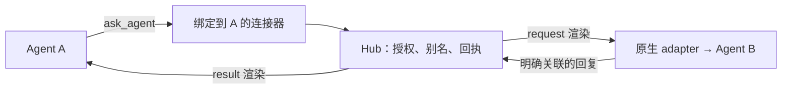

# Agent 自动接入与最小感知协作设计

[English](AGENT_CONNECTOR.md) · [现有架构](DESIGN.zh-CN.md) · [交付状态](ROADMAP.zh-CN.md)

状态：**设计第 11 版，实施中：两端连接器、Codex MCP connect 与显式启用的 Claude CLI connect 已实现**。日期：2026-11-05。代码基线：`a3093b9ca5a29bc34238529f3271afa062d51cd4`。messageKind、Claude/Codex 原生登记、三个共享 MCP 工具、受限 Agent CLI、connections 与两端 connect 已实现但未发布；实际配置和限制见[接入说明](CONNECTOR_SETUP.zh-CN.md)。Claude 原生 MCP 外部 reload、安装器卸载/停用、手工绑定兜底与完整只读就绪诊断仍待实现。当前可用能力及测试证据分别见 [API](API.zh-CN.md) 和[验证记录](VERIFICATION.zh-CN.md)。

## 1. 决策与首版范围

采用**原生消息通道 + 会话连接器 + 最小协作工具**。Agent 只表达“找谁、做什么、回复哪条请求”，程序负责身份、地址、编号、投递和回程。

v1 的主路径调整为**在通过兼容验收的宿主上，利用原生身份自动建立绑定**；所有者先安装接入配置并设置授权范围，逐会话手工绑定作为兜底。一个 Hub 只有一个隐式团队，使用原生名称前缀地址或所有者配置的别名。模型无需填写自己的会话 ID 或轮询。

[2026-11-05 隔离实验](SESSION_IDENTITY_EXPERIMENT.zh-CN.md)已验证：Claude MCP 启动环境有会话 UUID，但 `/clear` 后会过期；Codex App Server 的 MCP 调用携带逐调用身份。这些是身份输入依据；后续原型验证自动登记和刷新，正式实现仍待交付。

后续[收发原型实验](CONNECTOR_ROUNDTRIP_EXPERIMENT.zh-CN.md)已跑通两个方向，以及 clear 后绑定刷新、旧结果隔离和原生改名。该实验使用临时 registry 和结果渲染器。新增[安装、授权与生命周期实验](CONNECTOR_LIFECYCLE_EXPERIMENT.zh-CN.md)验证了 14 项检查、Codex 热加载及带正向对照的 clear 竞态；登记服务原型验证了权限分层和正常重启持久绑定。生产实现、配置工具及完整兼容矩阵仍待交付。

| v1 必须交付                                        | 后续增强                                       |
| -------------------------------------------------- | ---------------------------------------------- |
| 原生身份绑定、手工兜底、不可变 bindingId、名称消歧 | 更多宿主的自动配对、多团队、动态角色           |
| ask_agent、reply_agent、可选 list_peers            | 同步等待、请求级原生回复地址优化               |
| adapter 的 request / result 渲染及回复入口校验     | 更多 harness / 宿主的接入自动化                |
| 复用回执、去重和第一条回复转发，单一可配置期限     | 独立请求状态机、迟到结果自动投递、独立回程期限 |
| 必要消息字段及存储版本保护、现有容量限制           | 绑定代次状态机、周期租约、累计预算和细分限速   |
| 两个 Claude 会话及 Codex / Claude 双向验收         | 托管任务编排、远端接入                         |

首版聚焦本机根会话，优先 Claude。Windows 补齐、豆包运行时和子 Agent 保持 pending。独立托管任务的“正常输出即答案”沿用现有 ACP 授权边界，属于另一种使用模式。

## 2. 当前事实与依据

| 已有实现                                                                     | 对新设计的影响                                  |
| ---------------------------------------------------------------------------- | ----------------------------------------------- |
| 7 个 MCP 工具，send_message 要求 messageId、复合地址及 delivery              | 新增面向模型的简化入口，旧接口保持兼容          |
| HTTP token 确定调用方；originName 只是标签                                   | 会话绑定属于新增能力                            |
| 两端 adapter 已区分 request/result；结果消息省略回复模板                     | 阶段 1 已实现，后续连接器复用相同渲染及回复校验 |
| replyTo 转发第一条关联回复，继承原消息 expiresAt                             | v1 复用单一期限；独立回程窗口后置               |
| Claude 使用原生目录的 sessionId / pid，校验 PID 格式及 socket 类型、所属用户 | MCP / hook 的进程关系、启动时间核验仍需新增     |
| SQLite 保存回执、原始 envelope、固定转发 ID 和恢复状态                       | 扩展现有记录即可，首版无需另建请求数据库        |

代码依据：[MCP](../src/mcp.ts)、[Codex adapter](../src/adapters/codex.ts)、[Claude adapter](../src/adapters/claude.ts)、[核心路由](../src/hub.ts)、[存储](../src/store.ts)。

Claude 官方描述了原生消息在忙碌时进入工具调用间隙、空闲时启动轮次，以及原生回复。Hooks 带 session_id；Channels 需要会话 opt-in。因此选择原生收件，Hooks 用于生命周期辅助，MCP 用于主动协作。[原生消息](https://code.claude.com/docs/en/cross-session-messaging)、[Hooks](https://code.claude.com/docs/en/hooks#sessionstart)、[Channels](https://code.claude.com/docs/en/channels)。

Codex 的可复现依据改为已发布的 [rust-v0.166.0](https://github.com/openai/codex/releases/tag/rust-v0.166.0) 及该 tag 的[协议源码](https://raw.githubusercontent.com/openai/codex/rust-v0.166.0/codex-rs/app-server-protocol/src/protocol/v2/thread.rs)：ThreadStartParams 有 dynamic_tools，ThreadResumeParams / ThreadSettingsUpdateParams 没有该字段。原生动态工具仍按创建时注册处理；后续实验另行验证了已有 thread 通过 MCP 配置 reload 加载工具。这是两条不同路径。

## 3. 接入结构与就绪状态



连接器是会话级逻辑边界，可由 MCP stdio 或宿主工具集成实现。Hub 共享持久状态，adapter 负责原生消息。所有者先安装接入 profile 并设置受限凭证与授权范围。连接器提交宿主身份，Hub 核验后自动建立绑定；证据不足时报告待绑定状态，由所有者显式处理。模型侧协作工具在绑定及授权检查完成后可用。

v1 要求一个连接器对应一个会话。宿主若在多个会话之间共享 MCP 进程，必须提供可信的逐调用会话上下文；仅有一个全局 MCP 配置文件不足以实现来源绑定。这类宿主在验证前只使用已有底层接口。

就绪视图分开报告 `binding`、`connectorAvailable`、`nativeSessionAvailable`、`canReceive`、`canReply`、`canInitiate`、`canReturnResult`，附原因与检查时间。启动 Hub 后，原生收件可用的会话仍可能缺少主动协作工具。

- 已有 Claude 可继续走当前原生收件/JSON 回复；交互式 CLI 优先通过插件安装与 `/reload-plugins` 动态加载简化工具，再自动绑定。
- 已有 Codex 依据工具注册和原生监听判断回复就绪。所有者控制的新会话可在创建时初始化；已有会话继续走现有显式 attach 流程。
- 工具加载通过宿主支持的配置流程完成。安装输出分别显示配置已写入、工具已连接、身份已绑定；未完成的步骤给出下一次正常启动或显式 reload 提示。

### 统一的接入体验

已确认的产品目标是：**一条外部 CLI 同时完成安装和激活**。首版统一用户入口、连接状态和模型操作；需手动 reload 的宿主仍是接入缺口，不能算全自动完成。以下命令是**拟议接口，Codex connect 已实现；Claude connect 明确报自动激活不支持；connections 提供历史绑定诊断**：

```sh
agenthub serve                         # 已有命令：启动同一个 Hub
agenthub connect --harness claude      # 拟议：配置并接入选定的 Claude 宿主
agenthub connect --harness codex       # 拟议：配置并接入选定的 Codex 宿主
agenthub connections                   # 拟议：统一查看接入能力和下一步
```

`connect` 不指定 harness 时提供已发现实例的选择；指定后仍须解析到唯一实例和安装范围。复用所有者已授权的 profile/grants。安装范围（项目/用户/实例）与会话身份分开：配置一次可以供范围内的后续会话使用，每个会话仍独立核验和授权。重复执行应复用相同配置和绑定，保留其他 MCP/hook 条目。一个目标会话的选择不等于授权修改其他实例；Codex reload 的实例级影响需要在操作范围中明确显示。

统一流程为：**选择范围 → 预检自动激活能力 → 安装/复用连接器 → 激活 → 核验工具与身份 → 展示协作能力**。已授权且宿主提供程序接口的步骤由连接器执行。Claude 插件实测仍需要原会话的 `/reload-plugins`；这一手动步骤尚未被外部 CLI 取代。所有者不必手写 MCP JSON、复制 session UUID 或分别管理收发进程，但普通已有 Claude 的全自动激活还不能承诺。

安装返回相同结构的能力字段、检查时间和下一步操作：

| 对外显示        | 判断依据                                                     | 后续动作                                   |
| --------------- | ------------------------------------------------------------ | ------------------------------------------ |
| 协作就绪        | 当前身份已核验，主动发起、收件、回复和回程均有可用入口及授权 | 直接使用协作工具                           |
| 部分可用        | 只满足部分能力；逐项列明，例如可收件但没有主动发起工具       | 展示缺失能力及修复操作                     |
| 等待宿主操作    | 配置已写入，当前会话尚未加载                                 | 给出宿主命令、目标会话或下一次正常启动说明 |
| 等待身份上下文  | 工具可用，但尚缺可信的当前会话证据                           | 宿主事件或首次真实工具调用时自动完成核验   |
| 离线 / 暂不支持 | 会话不可用或宿主入口尚未验收                                 | 保留原因，不扩大支持矩阵                   |

这些是现有能力字段的展示结果，不引入独立的持久状态机。CLI 文案和机器可读结果来自同一诊断数据；下一步包含目标、操作类型和原因，调用方无需解析自然语言。配置写入、插件数量和 MCP 进程存活均不足以单独证明协作就绪。日常诊断保持只读；不会为了探测向工作会话发送测试消息或启动模型轮次。Codex connect 是显式接入动作，必要时通过原生 MCP API 调用一次 list_peers 完成登记；这不启动模型轮次，也不提交任务。

身份统一在**业务操作执行前**完成：Claude 可利用启动 UUID 并持续刷新；Codex 依据逐调用 metadata 在首次业务调用前建立绑定，以后每次重新核对。无需为了让登记时间一致而推断启动身份。首次 `ask_agent` 可以在同一次调用内完成核验和请求提交，模型仍只填写目标与正文；身份未确认时返回明确错误，业务尚未发送。

Agent 侧共享同一组逻辑工具及 schema：`list_peers`、`ask_agent`、`reply_agent`，返回相同的请求句柄、期限和回执。宿主可以添加自己的 MCP 命名空间；模型无需区分目标使用什么 harness。`@claude/reviewer`、`@codex/developer` 是可选的明确地址，所有者别名可隐藏前缀；同名歧义仍要求消歧。

实现复用同一个连接器核心和 Hub API，Claude 插件与 Codex 配置仅封装安装、激活和身份输入的差异。原生消息身份及不支持的能力继续按实际返回。该统一流程是设计约定：生产路径已验证两个宿主共享工具的真实双向收发与 Codex 安装激活；完整安装器仍待完善；Claude 可显式选用第 12 节的 CLI 激活路径；豆包及未验收宿主保持 pending。

### connect 的 CLI 约定

Codex 统一命令已覆盖首次安装和重复检查，实际使用还需 --connector-profile FILE；自动选目标及 Claude 激活仍是拟议能力：

```sh
agenthub connect
agenthub connect --harness claude --instance local --session-id SESSION_UUID
agenthub connect --harness codex --instance local --session-id SESSION_UUID
agenthub connect --harness claude --session-id SESSION_UUID --wait-ms 30000
```

省略目标时，交互终端展示候选供所有者选择；无交互输入且目标不唯一时，返回候选并停止，不按当前目录猜测来源或批量接入。沿用 `--url`、`--token-file` 和现有环境变量连接 Hub；Hub 不可用时报告原因，守护进程启动仍由已有 `agenthub serve` 负责。

命令依次检测宿主、解析已授权范围、幂等安装/复用配置、调用受支持的激活接口、核验就绪。等待期间只观察登记和连接状态；`--wait-ms` 限制等待时间，不以超时推断激活失败。再次执行复用已完成步骤，不创建替代会话。脚本模式 stdout 返回单个 JSON，交互提示和进度走 stderr；凭证正文不进入输出。

| 退出码 | 结果                           | 示例                                                  |
| ------ | ------------------------------ | ----------------------------------------------------- |
| 0      | 目标会话已具备所请求的协作能力 | 身份、工具、原生投递与回程已核验                      |
| 2      | 配置有效但接入尚未完成         | 等待宿主命令、首次身份上下文，或限时等待结束          |
| 1      | 本次无法继续                   | 目标歧义、宿主不支持、授权不足、配置冲突或 Hub 不可用 |

结果包含规范目标地址、当前阶段、能力字段、检查时间和 `nextAction`，另报告激活方式及其证据。预检确认缺少自动激活入口时，返回 `automatic_activation_unavailable`（退出码 1），默认保留当前配置；不能先安装再把手动步骤当作完成。已有待激活配置可解释原会话的 `/reload-plugins` 操作，但它仍不满足本次全自动要求。仅在宿主实际提示缓存影响后，说明 `--force` 的作用。

当前证据支持 Codex App Server 的程序化 reload 和 Claude 交互终端内的插件 reload；尚未验证对任意普通 Claude 现有终端会话发起外部 reload 的控制接口。官方明确跨会话消息里的 slash command 不会执行；已有私有原生历史也记录了 `queueSkipSlashCommands: true`。因此不能把发送 slash-command 文本当成 MCP reload。第 12 节采用的是原生 peer 请求触发既有 Bash 工具，不是远程执行 slash command。[Claude 消息边界](https://code.claude.com/docs/en/cross-session-messaging#how-a-session-treats-an-incoming-message)

全自动激活已是目标，必须验收实际入口。测试程序掌握自己创建的 PTY 输入，不代表可以控制任意已存在的终端。Agent SDK 持有的 Query、外部已有 CLI 会话以及桥接器托管的进程分别记录支持范围，保持 existing-live 的核心定位。

### Claude 的自动激活候选与缺口

[补充实验](CLAUDE_AUTO_ACTIVATION_EXPERIMENT.zh-CN.md)验证了非 strict 会话中外部安装插件、普通 local MCP 添加均未自动提供新工具，插件在原终端 reload 后才实际可用。另一个候选无需新增 MCP：外部添加 skill，原生协作消息触发 Skill，再调用本地 CLI。限定条件下已验证真实调用、进程祖先与 UUID 对应，以及 clear 后的新 UUID。

该候选尚不作为生产默认。空 skills 目录下有未加载的尝试；最终成功运行具有已加载的 baseline skill、项目设置及明确调用指令，条件尚未逐项归因。启动后才创建顶层 skills 目录的对照仍需要手动 reload。目录存在、文件写入成功和进程存活均不足以宣布自动激活完成。

后续若采用 skill/CLI，三个协作动作保持同一 Hub 语义，由 CLI helper 独立取得来源证据；模型中的 sessionId 参数不作为认证。需补受限凭证、Hub 独立进程核验、真实收发/撤权和宿主策略验收。安装器不扩大 scope 或 shell 权限来制造成功；任何需要模型轮次的激活核验必须明确属于接入动作，日常只读诊断仍不发送探测消息。

### 已实测的安装路径

| 宿主与入口                                                 | 首版行为                                                                                      | 证据边界                                                                                                         |
| ---------------------------------------------------------- | --------------------------------------------------------------------------------------------- | ---------------------------------------------------------------------------------------------------------------- |
| Codex App Server 0.166.0 / MCP 配置                        | 可显式调用 `config/mcpServer/reload`；检查同一 thread 的连接和实际工具调用后声明工具可用      | 隔离 App Server 已有 thread 成功；reload 会刷新该 server 的已加载线程，属于实例级操作；CLI/桌面未验收            |
| Claude 2.1.318 / 交互式 CLI 插件                           | 在所有者选定 scope 安装插件，在原会话执行 `/reload-plugins`；宿主提示缓存失效时使用 `--force` | 新 MCP 的真实模型调用成功，PID/UUID 不变；原工具可用，卸载后 reload 可移除；strict 模式首轮未观察到启动          |
| Claude 2.1.318 / `--strict-mcp-config --mcp-config <file>` | 写入配置后提示下一次正常启动生效；正常退出后可由所有者显式 resume                             | 新 server 在运行中未加载；停止后恢复同 UUID 成功；非 strict local MCP 添加亦未自动加载，项目文件路径不能据此推广 |
| Claude 已加载的 MCP server                                 | 允许宿主显式 reconnect，helper 重新登记并核验身份                                             | 已观察新 MCP PID、相同会话和绑定                                                                                 |
| Claude 项目 hooks                                          | 使用宿主文件监听加载；等待实际事件再报告生命周期信号可用                                      | 实测 UserPromptSubmit 热生效，不能替代 MCP 就绪检查                                                              |

所有者停用 profile 后，Hub 立即拒绝新业务调用；卸载只合并删除 AgentHub 自己的配置条目，保留其他工具和 hook。已加载进程何时退出由宿主控制。上述安装及停用是拟议产品行为，原型证据见[生命周期实验](CONNECTOR_LIFECYCLE_EXPERIMENT.zh-CN.md)与[插件热加载实验](CLAUDE_PLUGIN_HOTLOAD_EXPERIMENT.zh-CN.md)。插件将成为已测 CLI 的首选安装形态，正式插件尚未实现/发布。reload 由所有者在宿主执行；本轮未通过 peer 消息远程执行该命令。官方文档说明桌面/SDK/`-p` 的同名 slash command 不连接新插件 MCP；SDK 的 `setMcpServers()` 是另一条宿主控制路径，尚未实测。

## 4. 最小工具与等待体验

以下是拟议调用：

```text
ask_agent(to="reviewer", message="请检查这次修改的并发问题", deadlineSeconds=7200)
reply_agent(request="REQUEST_HANDLE", message="发现两个问题：……")
list_peers()  // 角色已经明确时无需调用
```

`deadlineSeconds` 可省略，默认 3600 秒，上限由所有者配置，v1 默认最大 14400 秒。当前连接器在调用开始时计算固定 expiresAt，Hub 按接收时间验证剩余窗口；上限暂固定为 14400 秒，所有者自定义上限待补。request 是现有 messageId 的不透明、可逆表示，由程序生成；模型复制消息中的句柄即可，恢复不依赖进程内短编号映射。

ask_agent 采用异步模式。返回包含 request、目标别名、当前投递证据、expiresAt 和操作提示，例如：

```json
{
  "request": "REQUEST_HANDLE",
  "peer": "reviewer",
  "deliveryStatus": "accepted",
  "expiresAt": "2026-11-05T12:00:00Z",
  "guidance": "请求已提交，答案尚未返回。可以继续独立工作；若后续步骤依赖答案，请向用户说明正在等待，然后结束本轮。结果会通过新消息送达，无需轮询或再次提交。"
}
```

该例不是完成任务的证明。未知投递返回 unknown 及“保留原请求，勿重复提交”的提示；即时校验失败直接返回工具错误。

等待期间按以下规则交互：

| 情况                   | 行为                                                                                    |
| ---------------------- | --------------------------------------------------------------------------------------- |
| 可以继续独立工作       | 模型继续当前任务中不依赖答案的部分                                                      |
| 必须等答案             | 模型向用户说明“正在等 reviewer 的检查，结果回来后继续”，结束当前轮次                    |
| 用户提出新问题         | 用户对话照常进行，原协作请求仍绑定原任务                                                |
| 结果到达时来源忙碌     | 使用已验证的原生排队机制，在允许的边界交付；模型结合当前用户指令处理                    |
| 用户已改变或放弃原任务 | result 提供原请求的简短任务说明和句柄，模型可将其作为参考；恢复旧任务由当前用户意图决定 |

结果只经一条异步消息返回。result 的操作提示为“这是请求 X 的结果；按当前任务需要使用，无需确认收件”。Hub 负责关联，任务优先级由模型依据用户当前指令决定。接入套件无需读取用户全部对话来推断优先级。

## 5. 身份绑定与自动配对

### 绑定记录、授权与地址

绑定可以由核验通过的原生证据自动创建，也可以由所有者显式创建；两者生成相同记录：

```ts
interface ConnectorBinding {
  bindingId: string; // Hub 创建的不可变标识
  callerId: string; // 独立受限调用方
  address: SessionAddress;
  alias: string; // Hub 内消歧后的地址或所有者设置的唯一别名
}
```

Hub 从绑定推导来源与回程。`@claude/reviewer`、`@codex/developer` 可以来自原生目录名称；同 harness 内也允许重名，所以解析结果不唯一时返回候选，要求用实例/ID 消歧。内部始终保存 `{harness, instance, nativeSessionId}`，提交时固定实际地址。原生改名只改变后续解析；别名改指其他会话或原生 UUID 变化时创建新 bindingId，在途请求保留旧标识。旧绑定失效后，答案保留在原回执，回程报告 binding_unavailable。

绑定沿用现有 grants。登记凭证仅允许提交登记证据；实际会话授权仍由所有者配置的 grants 决定，发现会话不会自动授予访问权。每次发送/回程复核原生可用性。自动识别失败时，所有者可以绑定一个明确的当前会话；显式绑定同样需要会话切换失效机制。

### 登记凭证与业务凭证

v1 采用原型已经验证的分层：所有者 profile 保存授权范围和登记凭证；登记凭证只能提交身份/hook，不能调用业务入口。Hub 完成核验后签发连接器进程凭证，绑定 PID、启动身份和 profile 撤销代次；每次业务调用重新推导当前会话，再应用现有 grants。登记成功不会扩大授权范围。

Hub 持久保存 bindingId 和凭证摘要。正常重启后恢复记录并重新核验活进程；MCP 重启后使用新进程证据重新登记，同一原生 UUID 可恢复同一绑定。所有者轮换登记凭证并提高撤销代次后，旧业务凭证失效；停用 profile 同时拒绝登记和业务调用。凭证失效返回明确错误，业务写操作沿用原回执/幂等规则，不因重新登记而盲目重发。

原型已验证两类凭证隔离、生产读取 grants、正常进程重启、轮换与停用；生产配置格式、存储兼容和强杀恢复属于实施验收。该机制沿用同一 OS 用户信任边界。

### Codex：逐调用原生身份

macOS / App Server 0.166.0 的两个隔离会话实际调用 MCP 时，`_meta.threadId`、`_meta.sessionId` 与原生动态工具请求中的 threadId 一致；MCP 环境没有 CODEX_THREAD_ID。连接器优先使用这些宿主字段，在已授权实例内核对根会话，建立该次调用对应的绑定，模型参数中无需包含来源 ID。

本次每个会话各有一个 MCP 进程，共用 App Server 父进程。共享 MCP 进程、CLI/TUI、桌面端及会话切换尚未验收，不能仅凭本轮 metadata 推广支持矩阵。身份字段缺失、不一致或对应实例不明确时保持未绑定。

### Claude：启动身份与生命周期刷新

Claude Code 2.1.318 的 headless 和交互式 MCP 启动环境均包含正确的 `CLAUDE_CODE_SESSION_ID`。但是交互式 `/clear` 改变 UUID 后，同一个 MCP 进程继续运行，环境仍是旧 UUID；SessionStart hook 和原生目录已更新。当前实测调用 metadata 没有新的 sessionId，因此不能永久缓存启动环境。

拟议流程：

1. 所有者安装同一接入 profile 与受限登记凭证。MCP helper 报告自身 PID 和启动 UUID；hook helper 报告自身 PID、事件与 session_id。Hub 从 OS 独立读取 UID、PPID 和进程启动信息。
2. 将父进程与原生目录 PID 交叉核对，匹配 `(profile, uid, boot identity, claude pid, claude start identity)`。macOS 实验已读到启动秒/微秒，两个同 cwd、同名会话分别匹配成功。中间 shell/祖先链只接受另行验证过的启动模板。
3. 提交前重读原生目录，核对 UUID、进程身份及 socket 所属用户。hook/MCP 任意先到时短暂保留证据；初始上限 60 秒，之后报告待核验或显式绑定。
4. SessionStart / SessionEnd 更新当前会话关系；`clear` / 切换必须使旧绑定失效，再以新 UUID 创建绑定。每次新协作调用重新核对原生目录；新旧证据冲突时暂停归因，等待核验。
5. 在途请求保留原来的 UUID 和 bindingId。旧结果不会因为进程或名称相同而转入新会话。PID 复用必须产生不同的启动身份。

生产 Hub 已实现逐调用核验和 SessionStart 刷新，并在 macOS + Claude 2.1.318 的真实 CLI/MCP 路径通过 clear 与旧结果隔离验收。当前实现遇到原生目录尚未刷新时拒绝 hook，不保留 60 秒待配对队列，也不自动重放失败 hook；后续启动顺序增强仍待实现。隔离原型已验证 clear 后刷新及旧结果隔离、正常停止后的 resume/fork、MCP 重连，以及目录读取后 clear、再向旧 UUID 写入的受控竞态；新 UUID 的前后正向对照均成功。该顺序下未观察到旧正文进入新会话，不能据此证明任意时序的原子性。异常退出、消息先入队再 clear、真实 PID 复用及其他事件/调用竞态仍需验收。Linux 的 `/proc` 启动 tick / boot identity 路径待实测。缺少持续身份核验能力的宿主保持未就绪，不能用一次手工绑定掩盖后续切换问题。

详细操作、13 项断言及隔离边界见[实验记录](SESSION_IDENTITY_EXPERIMENT.zh-CN.md)。这些字段属于同一 OS 用户边界内的宿主证据，不是远程身份认证。

### 存活信号

v1 使用连接状态和每次 I/O 前的原生会话检查。后续若启用 30 秒续租、90 秒失效，租约**只表示连接器近期存活**。原生会话存活由 SessionEnd、原生目录/loaded 状态及进程启动身份共同判断；MCP 活着或重启不能单独证明它仍属于原会话。只有两类状态均满足时才声明协作就绪。

## 6. adapter 的 request / result 渲染

这是**阶段 1 的交付物，已在当前分支实现但未发布**。新增可选 `messageKind: 'request' | 'result'`，贯穿消息校验、SDK/OpenAPI、指纹、持久化、转发和两端 adapter。省略时保留旧调用语义；连接器调用必须显式设置。

| 渲染/行为    | request                                                              | result                                                          |
| ------------ | -------------------------------------------------------------------- | --------------------------------------------------------------- |
| 模型可见内容 | 来源别名、任务正文、请求句柄、期限                                   | 原请求句柄、简短任务说明、答案、原生来源                        |
| Codex        | 根据就绪能力给出 agenthub_reply 或简化回复入口                       | 省略硬编码 reply 对象和回复提示                                 |
| Claude       | 简化工具已安装时给出 reply_agent；native-only 保留当前关联 JSON 路径 | 省略 payload.reply 及 inReplyTo JSON 回复模板；保留必要传输来源 |
| 核心路由     | 可设置 replyTo，记录可接受回复的原请求                               | replyTo 必须为空；回程标记为 result                             |
| 回复入口     | 校验目标会话/调用方与原请求匹配，第一条有效回复胜出                  | 以 result ID 为 inReplyTo 的业务回复直接拒绝或忽略，记录诊断    |

Claude 的传输级收件状态仍可记录；它与应用层“请回复”是两回事。Codex 工具请求处理器和 Claude callback 接收器均需识别 result，核心再做一次校验。即使模型仍调用回复工具，这条调用也不会形成新的业务回复或转发链。

这一设计保证 Hub 不自动形成答谢循环。模型另行调用 ask_agent 属于新请求，受既有权限、容量和所有者停用控制；它不是 hopCount 能完全约束的行为。累计协作预算放到后续阶段。

## 7. 投递、期限与最小持久化

流程为：检查绑定/双方能力 → 固定地址并生成 ID → 持久保留原请求 → 原生投递 → 接收明确回复 → 保存固定结果 ID → 以 result 渲染回程。Hub 已有的回执区分“有答案”和“结果派发”，继续沿用。

v1 在“迟到结果再投递”和“可选 deadline”之间选择后者：默认一小时，长任务可在发起时指定更长等待时间。expiresAt 同时约束原请求投递、回复接收与自动回程，保持现有单一期限模型。模型收到的 request 和发起确认均显示期限。

期限到达时，诊断标记等待窗口已结束，保留已有证据；这不是取消执行或确认未送达。严格超期的原生回复沿用当前适配器的处理边界，来源仍可由所有者授权查看目标历史。结果在期限附近形成但回程已超期时，答案留在回执并显示 forwardError。**v1 不承诺超期后的自动通知或唤醒**；自动 late result 和独立回程窗口属于后续增强。参数说明应在发起前把这一点说清楚。

持久化只做必要增量：

- 复用现有 envelope、receipt、replyTo、固定 forwardedMessageId 和转发状态；句柄直接还原 messageId。
- 当前消息记录保存 messageKind 和不可变的 origin.session/replyTo 原生地址；独立绑定 ID 保存在连接器注册表，尚未写入 envelope。回程按旧 UUID 和现有 grants 校验，不跟随名称或 clear 迁移。跨宿主的绑定 ID 关联仍待后续统一。
- 沿用现有事务与崩溃恢复。需要一次最小存储版本升级，防止旧二进制读到 result 后按旧模式附加回复指令；保留旧记录兼容测试，暂不建设通用迁移框架或新请求表。
- 回执保留上限沿用 24 小时 / 10,000 条，容量不足在原生 I/O 前报错。Hub 重启后通过原记录恢复查询；连接器重连须重新检查对应会话。

当前实现不自动重试写请求；失败包含请求 ID 供所有者查询。低层相同 ID/载荷仍按核心规则去重。按稳定宿主 tool-call ID 去重尚未实现。MCP 的连接内请求号和文本相同的两次模型调用不代表同一请求。unknown 保留不确定性，诊断引导查询原回执。

## 8. 不变量清单

流程和测试统一引用下列约束，避免分散在各段。

| 编号              | 不变量                                                                   | 验证方式                       |
| ----------------- | ------------------------------------------------------------------------ | ------------------------------ |
| I1 来源与授权     | 来源由绑定确定；发送、回复和回程均受现有 grants 约束；句柄只用于关联     | 冒充来源、跨会话回复、撤权用例 |
| I2 原生身份       | peer_message / tool_output 保持各自语义，peer 消息不提供用户许可         | 原生历史与审批边界断言         |
| I3 工作会话连续性 | 接入按实际能力工作；恢复、重启、审批和权限修改由所有者显式操作           | 缺工具/监听时的调用轨迹        |
| I4 可靠关联       | 地址在提交时固定；第一条明确回复胜出；更换别名不迁移在途请求             | 并发、乱序、别名替换用例       |
| I5 结果终止       | result 没有回复模板和 replyTo；业务回复入口拒绝对 result 的回复          | 两端渲染合同及恶意/误发回调    |
| I6 不确定性       | 保留真实投递证据；unknown 不换 ID 重发；接受不等于模型已读               | 写入后断线、重启用例           |
| I7 最小披露       | 默认仅共享显式正文和必要关联；凭证、用户其他回答及未选择的历史留在原边界 | 用户插话、日志与上下文检查     |
| I8 本地信任       | 同一 OS 用户是边界；进程核验用于避免误绑定，不声称防御同用户恶意代码     | 证据缺失、PID 复用及歧义处理   |
| I9 受限资源       | 使用既有期限、容量和自有资源清理规则；满载明确拒绝                       | 容量、到期、端点所有权测试     |
| I10 隔离验证      | 真实写验收只使用新建 allowlist 会话和自有配置                            | 创建清单、清理及私有报告核对   |

## 9. 实施拆分与验收

各阶段先补合同测试，再做真实验收。阶段 1 已实现；阶段 2 核心路径通过 9 项真实检查；阶段 3 的 Codex 接入与两端双向协作通过 6 项真实检查。Claude 原生 MCP 外部 reload、卸载、手工兜底、完整诊断及剩余故障场景仍待完成。

| 阶段                  | 交付物                                                                 | 验收门槛                                                        |
| --------------------- | ---------------------------------------------------------------------- | --------------------------------------------------------------- |
| 1：消息语义（已实现） | request/result 字段与两端渲染、回复入口/核心双重校验、最小存储版本保护 | I2/I5/I6；旧消息兼容，结果无法形成回复转发链                    |
| 2：Claude v1          | 原生身份登记、生命周期刷新、手工兜底、名称消歧、最小工具和等待提示     | 两个真实 Claude 模型通过工具主动协作，覆盖 I1/I4/I7/I9          |
| 3：Codex 闭环及交付   | 支持的 Codex 工具/监听接入、双向 E2E、安装/停用说明、兼容矩阵          | Claude → Codex 与 Codex → Claude；工作会话边界 I3/I10；包验收   |
| A：宿主兼容扩展       | 在本轮身份实验基础上，逐宿主验证自动登记与生命周期                     | 逐宿主验证启动顺序、启动时间、共享进程、fork/clear/PID 复用；I8 |

实验覆盖身份输入、双向收发、基本安装/授权/生命周期和 CLI 插件动态加载；阶段 2 已接入生产代码并验收双向主动发起、用户等待期间插话、正常重启、clear 刷新及旧结果隔离。用户插话验收是先完成用户轮次、再收到结果，不代表所有忙碌边界的交错已覆盖。阶段 A 扩展其他宿主，不阻塞已验收宿主的 v1。多团队、租约、双期限、迟到投递和高级预算分别按需求设计。

| 必要场景                 | 可观察的通过标准                                                                         |
| ------------------------ | ---------------------------------------------------------------------------------------- |
| 双向自主协作             | 两个真实模型分别发起 ask_agent；由模型生成回复，测试程序仅设置场景与断言                 |
| request / result         | 两端 result 无回复模板；强制对 result 调用回复工具也不会产生业务转发                     |
| busy / idle              | 按已支持的原生机制排队或启动轮次，正在运行的工具保持连续                                 |
| 并发和乱序               | 两个请求的答案各归其位；回调先于 ask 确认也只返回一次结果                                |
| 发起方等待期间被用户占用 | 新用户问题正常处理；结果带原请求关联，不被当成新用户指令或当前问题的答案                 |
| 发起方必须等待           | 工具确认引导模型告知用户并结束本轮；结果到达后可继续，过程无需轮询                       |
| 长任务与期限             | 可选 deadline 生效；长于旧 10 分钟但仍在新期限内的答案正常返回；超期/边界行为准确可见    |
| 身份与别名               | 同 cwd 多会话、连接器复用、别名替换和撤权不会将请求送到错误来源                          |
| 恢复与容量               | 重启、unknown、重复回调、容量耗尽遵守现有回执语义                                        |
| 能力不足                 | 缺工具、监听、可靠会话上下文或回程入口时，报告具体未就绪原因                             |
| 外部自动激活             | 一条 CLI 完成安装和激活，原宿主会话连续；手动 reload、安装成功或工具数量不能作为通过依据 |

协议 fixture、MCP 客户端测试、合成负载与真实模型 E2E 分别记录。文档检查以及既有项目测试均不能作为此新方案的运行时证据。

## 10. 已收敛的选择与剩余验收

首版按本机、已测版本和入口实施：原生身份自动登记、进程凭证与会话 grants 分层、单一团队、不可变地址、request/result 分离。安装诊断区分 Codex App Server reload、Claude 交互式 CLI 插件 reload，以及受限入口的下次正常启动路径。基本机制已有真实原型证据，尚不代表所有产品场景已通过。

Claude 原生 MCP 外部 reload 仍无已验证控制入口。第 12 节的 CLI 路径已提供另一种接入方式；它需要模型执行和现有 Bash 权限，不能等同于任意会话无审批接入。

| 待验收内容                              | 验证方式                                                  | 对范围的影响                                 |
| --------------------------------------- | --------------------------------------------------------- | -------------------------------------------- |
| Claude 激活、卸载及剩余配置/存储异常    | 配置合并/冲突、旧记录兼容、打包安装测试                   | 首版交付门槛                                 |
| 并发乱序、忙碌时用户插话及完整期限矩阵  | 生产工具及 adapter 上的隔离真实模型 E2E，加确定性合同测试 | 首版交付门槛                                 |
| 强杀恢复、失联、消息入队后 clear        | 在途消息故障注入，保持 unknown 和固定 ID，核验内容归属    | 首版可靠性验收，不能以正常重启代替           |
| 其他入口/平台、共享 MCP、实际 PID 复用  | 分别建立正向对照和身份切换场景                            | 扩展支持矩阵，未通过前保持未就绪             |
| 请求级 native callback、稳定工具调用 ID | 记录宿主版本、资源上限和跨重连行为                        | 后续优化；当前保留明确回复句柄和有限去重范围 |

领取结果句柄的跨会话拒绝已在原型验证，可作为后续防线；尚不新增为 v1 必选工具。当前回程继续使用已验证的原生目标 ID，并在缺少当前绑定证据时暂停投递。

## 11. 第 10 版实施结果

Codex connect 已在已有、空闲根线程上完成配置版本校验、热加载、原生 MCP 只读握手和身份登记；无需模型轮次、动态回复工具或 thread/resume。首次握手只有 threadId，模型调用还带 sessionId（存在时必须一致）；两者均与当前实例的 MCP 启动标识交叉核验。详见[接入说明](CONNECTOR_SETUP.zh-CN.md)及[验证记录](VERIFICATION.zh-CN.md)。这更新了上文“等待首次模型调用”的原始设想；三工具业务语义不变。

仍需推进 Claude 原生 MCP 外部 reload、安装器卸载/停用、自动 profile/目标选择、完整只读诊断和未覆盖故障时序；Windows、豆包保持 pending。

## 12. 第 11 版实现结果：Claude CLI 激活

所有者可显式配置 Claude profile 的 `transport: cli`，同一 `agenthub connect` 通过原生 peer 消息请求一次本地身份握手。它不安装 skill/MCP、不依赖目录监听或 hook；模型使用已有 Bash 执行受限 `agenthub agent list-peers / ask / reply`，共享原有身份、grants、request/result 和期限语义。

Hub 独立核验最多 8 层进程祖先与原生 UUID，CLI 每次启动读取当前身份。激活 ID 持久保存，只有目标原生进程链中的真实 CLI 调用可以完成它；文本回复、HTTP accepted 或历史 binding 均不足以返回成功。重复 connect 不重复发消息，过期后仅通过显式 retry 创建新握手。注册表上限 256 条，自动回收后置。

该路径会启动或加入模型轮次，权限仍由目标 Claude 决定。没有 Bash、收件被拒绝、命令需审批或模型不执行时返回未核验。`cliVerified` 与 `toolsConnected` 分开报告；不会将 CLI 能力描述为新 MCP 工具已加载。真实验收通过两 Claude 的 10 项检查（含 Bash 不可用的反例）及 Claude CLI ↔ Codex MCP 的 7 项检查。适用范围及失败尝试见[验证记录](VERIFICATION.zh-CN.md)，操作见[接入说明](CONNECTOR_SETUP.zh-CN.md)。
