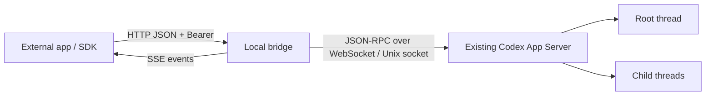

# Architecture and compatibility

[简体中文](ARCHITECTURE.zh-CN.md) · [API](API.md)

## Transport and responsibility

The bridge is an adapter for one existing backend. It never starts another Codex process, writes a rollout file, or tries to move an active thread between processes. The CLI binds to loopback; the SDK uses fetch and can run in browsers with explicit CORS permission.

App Server's Unix control socket carries a **WebSocket handshake and frames**. Sending newline-delimited JSON directly to the socket is not sufficient. `ws` supplies framing; `node:net` connects to the Unix socket. Initialization requests experimental APIs, then sends `initialized`.

The only production runtime dependency is `ws`. Node provides HTTP, crypto, events, file access and the test runner. Strict TypeScript and a route registry make the public boundary explicit.

| Module                    | Responsibility                                                                                    |
| ------------------------- | ------------------------------------------------------------------------------------------------- |
| `rpc.ts`                  | Initialization, request correlation, transport limits, server requests, timeout/disconnect errors |
| `bridge.ts`               | Loaded-thread checks, root-input restriction, attribution, message idempotency                    |
| `routes.ts`, `schemas.ts` | Input validation and OpenAPI generation from the same route definitions                           |
| `server.ts`               | Auth/CORS, routing, bounded SSE streams, pending interaction lifecycle                            |
| `events.ts`               | Process-local ordered event cursor and bounded replay                                             |
| `sdk.ts`                  | Typed fetch methods, structured errors, streaming UTF-8 SSE parsing                               |
| `config.ts`, `cli.ts`     | Private token, loopback listener, reconnect backoff and shutdown                                  |

## Native MultiAgentV2 versus external input

Native `send_message` and `followup_task` are agent tools inside Codex, not App Server OpenAPI endpoints. Their `QueueOnly` and `TriggerTurn` delivery modes operate through an internal agent tree and mailbox. External applications cannot call those tool names through this bridge.

This project exposes its own REST API, described by OpenAPI 3.1, over available App Server JSON-RPC methods. `/messages` produces ordinary user input with a visible source prefix. The source label is not a native sender identity. It can start or steer root-thread work, but does not claim native mailbox semantics or direct child-agent control. `/context` injects user-role context without starting a turn; UI rendering varies.

An actual native mailbox adapter would require an upstream transport extension with explicit agent-tree targeting, authorization, lifecycle semantics and UI events. It is outside the initial implementation. No experimental private desktop socket protocol is assumed beyond the verified App Server control socket.

## Observing existing sessions

Read operations can inspect stored history without loading the thread. Sending requires a loaded target. Notifications are scoped to the bridge's connection and its subscriptions, not every thread stored on disk.

There is no atomic subscribe-only App Server request. Explicit `/attach` checks loaded IDs, then uses `thread/resume`. A concurrent unload can turn that into restoration. This boundary is exposed to callers; message submission never calls resume. `/resume` is the explicit restore operation.

Multiple Codex instances can share storage but have different loaded threads and event streams. Select the correct socket and inspect loaded IDs. Do not infer ownership from a history entry. Shutdown closes only the bridge's HTTP listener and WebSocket connection, not Codex or its turns.

## Failure semantics

Message receipts are reserved before awaiting any backend request. Concurrent duplicate keys share one promise, including failed or uncertain outcomes. Payload fingerprints are SHA-256 hashes; message text is not retained in the receipt cache. Entries expire 24 hours after settlement and are never evicted early to admit more writes.

Neither the RPC layer nor SDK retries writes. The CLI reconnects with exponential backoff (1–30 seconds), but does not restore subscriptions or repeat operations. `deliveryUnknown` distinguishes a submitted write with an uncertain result from an unavailable connection. An accepted result still requires observing a terminal turn status.

Replay uses a random process epoch and monotonic sequence. A fresh process, expired cursor or lost backend connection requires history reconciliation. The bridge does not promise exactly-once execution across restarts, a durable inbox, globally ordered events, multi-user authorization, or failover between backends.

Approvals/questions are explicit server requests. The bridge retains them for five minutes, forwards caller-provided results, and clears them on resolution or disconnect. Unknown request types remain visible by method and parameters; the application must decide how to present them. Expiration returns an error, never approval.

## Compatibility evidence

The local read-only smoke probe succeeded on 2026-11-04 against Codex CLI/App Server `0.166.0` on macOS: initialization, loaded IDs, list, detail, cross-session search, turns, items and within-session occurrences. It read counts without printing conversation contents. This confirms the connected backend, not every desktop installation or operating system.

Public source was inspected at commit `f2b94ef8b52196f127d162c6db71e390b9bb265c`. Relevant files:

- [App Server protocol and usage](https://github.com/openai/codex/blob/f2b94ef8b52196f127d162c6db71e390b9bb265c/codex-rs/app-server/README.md)
- [Server transport](https://github.com/openai/codex/blob/f2b94ef8b52196f127d162c6db71e390b9bb265c/codex-rs/app-server/src/transport.rs)
- [Thread methods](https://github.com/openai/codex/blob/f2b94ef8b52196f127d162c6db71e390b9bb265c/codex-rs/app-server-protocol/src/protocol/v2/thread.rs)
- [Turn methods](https://github.com/openai/codex/blob/f2b94ef8b52196f127d162c6db71e390b9bb265c/codex-rs/app-server-protocol/src/protocol/v2/turn.rs)

The ordinary test suite verifies mutations against a simulated WebSocket peer, including stale-turn rejection without fallback. CI runs without a Codex login or model calls. `smoke:readonly` performs reads only and never attaches, resumes or sends input.

On 2026-11-04, the opt-in `smoke:live` probe also passed against an **existing, loaded, idle root session** on the local backend. It exercised SDK → HTTP → JSON-RPC → real model → SSE → persisted history and within-session search in 5,655 ms:

- Attributed user input was accepted and emitted `turn.started`.
- Text deltas exactly reproduced a unique test marker; `turn.completed` had status `completed`.
- History contained one user message and one assistant reply, with no model tool calls.
- Repeating the same idempotency key returned the same receipt; exactly one new turn existed.
- Both input and reply were found by within-session search; the bridge detached afterward.

The detailed reports remain in the local ignored verification directory, not the published package. A subsequent isolated suite on the same date passed **25 checks covering all 22 API operations**, with real steering, interrupted waiting input, injected context recalled by the model, question responses, command-approval acceptance and decline, bounded forks, archive/unarchive, and resume followed by another model reply. All mutations were restricted to sessions created by the suite; cleanup confirmed they were unloaded. See the [verification matrix](VERIFICATION.md).

The suite uncovered upstream behavior that its first assumptions did not account for: normal lists exclude empty-preview forks; immediate interruption can race task startup; and fork notifications can precede the fork response. It also made exact-output prompts unambiguous and added tests for the fixed-command approval allowlist. No global configuration or user work session was changed by the isolated suite. Desktop/CLI visual rendering remains unverified; passing these cases does not guarantee every Codex version or every error/concurrency scenario.

## Release boundaries

Version 0.1.0 is an initial local implementation. The npm name is a package name, not a claim of registry publication. Manual packaging uses `npm pack`; CI validates a dry run and never publishes. Planned extensions should keep backend adapters separate: durable receipts, scoped app credentials, additional SDK languages, a native mailbox adapter if upstream provides one, and version-specific capability negotiation.
