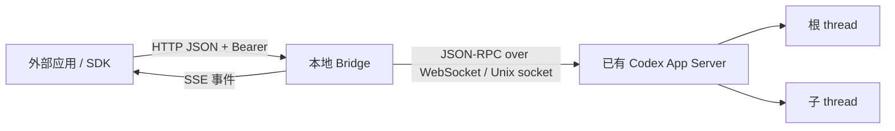

# 架构与兼容性

[English](ARCHITECTURE.md) · [API](API.zh-CN.md)

## 传输与职责

Bridge 适配一个已运行后端，不会启动第二个 Codex、直接修改 rollout 文件，也不会跨进程迁移活动 thread。CLI 监听 loopback；SDK 基于 fetch，浏览器需显式允许 CORS 来源。

App Server 的 Unix 控制 socket 承载 **WebSocket 握手和帧**，不能直接发送以换行分隔的 JSON。`ws` 负责 WebSocket 协议，`node:net` 负责 Unix socket 连接；初始化时声明 experimental API，再发送 `initialized`。

生产运行时只有 `ws` 一个依赖；HTTP、加密、事件、文件与测试运行器都使用 Node 内置能力。严格 TypeScript 与统一路由定义约束对外接口。

| 模块                      | 职责                                                |
| ------------------------- | --------------------------------------------------- |
| `rpc.ts`                  | 握手、请求关联、传输限制、服务端请求、超时/断线错误 |
| `bridge.ts`               | 已加载检查、根会话输入限制、来源标记、消息幂等      |
| `routes.ts`、`schemas.ts` | 参数校验，以及由相同路由定义生成 OpenAPI            |
| `server.ts`               | 鉴权/CORS、路由、有界 SSE、待处理交互生命周期       |
| `events.ts`               | 进程内事件顺序、游标和有界回放                      |
| `sdk.ts`                  | 类型化 fetch 方法、结构化错误、UTF-8 SSE 流解析     |
| `config.ts`、`cli.ts`     | 私有 token、loopback 监听、重连退避、关闭           |

## 原生 MultiAgentV2 与外部输入

原生 `send_message`、`followup_task` 是 Codex 内部的 agent 工具，不是 App Server OpenAPI 端点。其 `QueueOnly`、`TriggerTurn` 模式依赖内部 agent 树与 mailbox，外部应用不能通过本项目直接调用这些工具名。

本项目在可用的 App Server JSON-RPC 方法上封装独立 REST API，并提供 OpenAPI 3.1 描述。`/messages` 产生带可见来源前缀的普通用户输入；来源不是原生 sender 身份。可以向根 thread 启动/追加任务，但不具备原生邮箱或子 agent 直接控制语义。`/context` 注入用户角色上下文而不启动轮次，显示方式由 UI 决定。

真正的原生邮箱适配需要上游增加传输接口，明确 agent 树寻址、鉴权、生命周期和 UI 事件，首版不包含该能力。本项目仅使用已验证的 App Server 控制 socket，不假设其他桌面私有协议。

## 观察已有会话

读取历史不要求加载 thread，发消息要求目标已加载。通知只覆盖此 Bridge 连接及其订阅，不覆盖磁盘上的所有会话。

上游没有原子的“仅订阅”方法。显式 `/attach` 先查已加载 ID，再调用 `thread/resume`；如果中间被卸载，仍可能变成恢复操作。这个边界明确暴露给调用者，消息提交自身不会调用 resume；`/resume` 是显式恢复接口。

多个 Codex 实例可能共享存储，但已加载 thread 和事件流不同。应选对 socket，并检查已加载 ID，不能从历史记录推断当前会话归属。关闭 Bridge 只关闭自己的 HTTP 监听与 WebSocket，不会关闭 Codex 或中断其轮次。

## 失败语义

消息回执在任何异步后端操作前占位，同 key 并发请求共享一次 promise，包括失败和结果不确定的情况。载荷使用 SHA-256 指纹，回执缓存不保留消息正文。条目在结束后 24 小时过期，不会为了接收新请求提前淘汰旧回执。

RPC 与 SDK 都不自动重试写请求。CLI 用 1–30 秒指数退避重连，但不自动恢复订阅或重复操作。`deliveryUnknown` 表示已尝试提交的写操作结果不确定；收到 accepted 后仍需观察轮次最终状态。

事件游标使用随机进程 epoch 和递增序号。进程重启、游标过期、后端断线都要求重新核对历史。Bridge 不承诺跨重启 exactly-once、持久 inbox、全局事件顺序、多用户授权或后端自动故障切换。

审批/问题作为显式服务端请求保留五分钟，转发调用方提供的结果，并在解决或断线后清理。未知类型保留原方法与参数，由集成应用决定如何展示。过期只返回错误，不会默认批准。

## 兼容性证据

2026-11-04 在 macOS 的 Codex CLI/App Server `0.166.0` 上通过真实只读冒烟测试：握手、已加载 ID、列表、详情、跨会话搜索、轮次、消息和会话内搜索。脚本只打印计数，不打印对话正文。这证明了当前所连后端，不代表所有桌面安装方式或操作系统都已验证。

检查的公开源码版本为 `f2b94ef8b52196f127d162c6db71e390b9bb265c`，主要位置：

- [App Server 协议与用法](https://github.com/openai/codex/blob/f2b94ef8b52196f127d162c6db71e390b9bb265c/codex-rs/app-server/README.md)
- [服务端传输](https://github.com/openai/codex/blob/f2b94ef8b52196f127d162c6db71e390b9bb265c/codex-rs/app-server/src/transport.rs)
- [Thread 方法](https://github.com/openai/codex/blob/f2b94ef8b52196f127d162c6db71e390b9bb265c/codex-rs/app-server-protocol/src/protocol/v2/thread.rs)
- [Turn 方法](https://github.com/openai/codex/blob/f2b94ef8b52196f127d162c6db71e390b9bb265c/codex-rs/app-server-protocol/src/protocol/v2/turn.rs)

常规写操作测试使用模拟 WebSocket 对端，包含过期 steer 不回退启动。CI 不需要 Codex 登录、不调用模型；`smoke:readonly` 只读，不 attach、不 resume、不发送输入。

2026-11-04，手动启用的 `smoke:live` 也在本机后端的一个**已有、已加载、空闲根会话**上通过，覆盖 SDK → HTTP → JSON-RPC → 真实模型 → SSE → 持久历史与会话内搜索，共耗时 5,655 毫秒：

- 带来源的用户输入被接受，收到 `turn.started`。
- 文本增量准确还原唯一测试标记，`turn.completed` 的状态为 `completed`。
- 历史中有且仅有一条用户输入和一条助手回复，没有模型工具调用。
- 相同幂等键重复提交返回同一回执，确认只新增一个轮次。
- 输入和回复均能通过会话内搜索找到，完成后取消 Bridge 订阅。

详细报告保留在本地被忽略的验证目录，不进入发布包。随后同日运行的隔离验收通过了**覆盖全部 22 个 API 操作的 25 项检查**，包括真实 steer、等待输入时中断、模型回忆注入上下文、提问回复、命令审批允许/拒绝、限定历史的 fork、归档/取消归档，以及恢复后再次得到模型回复。所有写操作仅针对测试程序创建的会话，清理时确认全部卸载。详见[验收矩阵](VERIFICATION.zh-CN.md)。

验收修正了最初未考虑的上游行为：普通列表排除空预览 fork；立即中断可能与任务启动竞态；fork 通知可能先于 fork 回执到达。同时消除了固定输出指令中的标点歧义，并为审批命令白名单增加测试。隔离验收没有修改全局配置或用户工作会话。桌面/CLI 视觉展示仍未验证；这些用例通过，不代表任意 Codex 版本和所有错误/并发组合都已覆盖。

## 发布边界

0.1.0 是首版本地实现，npm 名称只是 package 名，尚未宣称发布到注册表。手动通过 `npm pack` 打包，CI 验证 dry run，不自动发布。后续可扩展持久化回执、应用级授权、更多语言 SDK、上游支持后的原生 mailbox 适配，以及按后端版本协商能力；这些应保持在独立适配层中。
